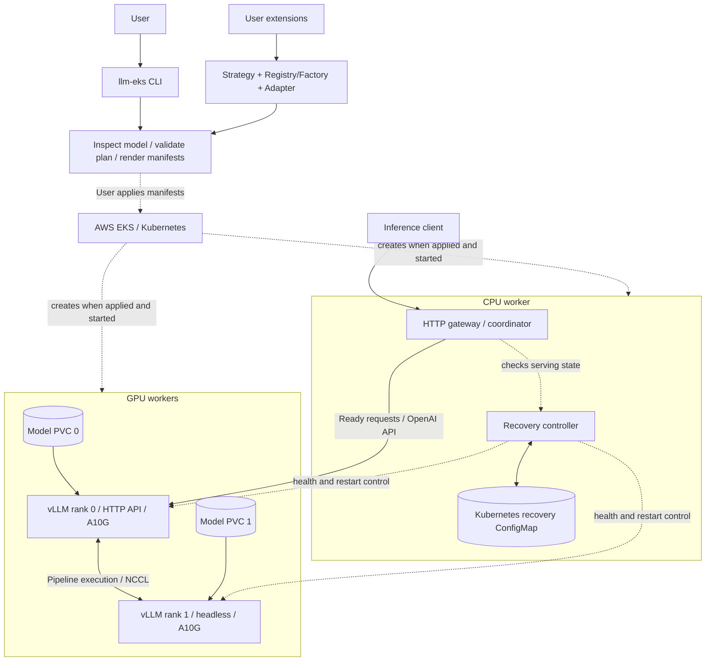

# Architecture

LLM-EKS separates model and deployment planning from the inference engine.

The current reference runs Qwen3-14B on two NVIDIA A10G GPUs through vLLM. A CPU gateway and a CPU recovery controller manage access and lifecycle.

## Reference deployment and interfaces

The CPU gateway handles incoming `/v1/completions` and `/v1/chat/completions` requests and checks health before forwarding them to rank 0.

Rank 1 participates in distributed model execution but does not expose a user API.

**vLLM handles batching, attention, and KV-cache management** in the reference path. The framework handles planning, integration, health gating, and lifecycle controls.

CPU coordination and recovery were already present in V1 with the custom PyTorch/NCCL pipeline. V3.3 adapted these responsibilities for the vLLM workers.

Recovery state is stored in Kubernetes. The gateway can block requests when the engine is not ready.

Generated deployments start at zero replicas. Automatic recovery is disabled by default.

## Three user journeys

### 1. Use directly

Use the validated Qwen3-14B configuration.

Install the package, create a plan, and render Kubernetes manifests. Review the manifests and provision the GPU nodes, model storage, and networking before applying them.

The CLI does not automatically deploy or start the cluster.

Start with [the default workflow](../examples/basic/README.md).

### 2. Change the model

For a compatible non-quantized BF16 Qwen3 model:

1. Provide the model configuration and Safetensors index.
2. Generate model layout metadata.
3. Generate a new distributed execution plan.
4. Render the GPU-worker Kubernetes resources.

The current renderer does not provision new storage or generate a dedicated coordinator and recovery stack for the replacement model.

Successful planning does not guarantee that the model fits in GPU memory.

Start with [the model-swap workflow](../examples/model_swap/README.md).

### 3. Fully customize

Provide trusted extension modules and select them through the registry.

Supported customization includes model inspection, backend planning, scheduling policies, selected Kubernetes resource settings, and runtime adapters for custom engines.

The framework uses three complementary design patterns:

- **Strategy:** Select a different implementation for a defined behavior.
- **Registry/Factory:** Register, validate compatibility, and construct implementations.
- **Adapter:** Provide consistent interfaces for external backends.

A custom backend may expose CLI planning/rendering methods or runtime generation methods. These are distinct contracts.

Custom code does not automatically integrate with the reference vLLM GPU deployment.

Start with [custom extensions](../examples/custom_extensions/README.md).

## Current limitations

The older custom research-runtime attention and KV-cache interfaces do not replace native vLLM attention or KV-cache implementations.

A custom vLLM scheduler class was loaded during real distributed GPU inference, but the interface is version-sensitive.

Compatibility and live behavior must be checked for each model and backend.

This is a validated reference framework, not a production-certified serving service.
